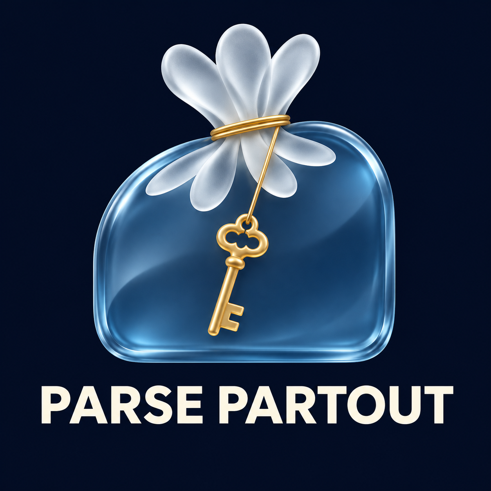

  

# Parse Partout

L'addon de la guilde **Parse Partout**, pour **World of Warcraft: Forever**.
*The Parse Partout guild's addon, for World of Warcraft: Forever. [English below](#english).*

> **En construction.** Pour l'instant, c'est un squelette : l'addon se charge, ouvre une fenêtre de
> verre vide et a une page d'options. Les fonctions de la guilde arrivent une à une.

## Installer

Installez **Parse Partout** depuis [CurseForge](https://www.curseforge.com/projects/1787925) avec
l'application CurseForge, ou téléchargez le zip depuis les
[Releases GitHub](https://github.com/Spotnick2/ParsePartout/releases) et décompressez-le dans le
dossier `Interface\AddOns` de votre dossier de jeu Forever. Puis `/reload`, ou lancez le jeu.

## Commandes

| Commande | |
|---|---|
| `/partout` | ouvrir ou fermer la fenêtre |
| `/partout langue auto/fr/en` | la langue de l'addon (`auto` : celle du jeu) |
| `/partout options` | ouvrir la page d'options (Échap > Options > AddOns > Parse Partout) |
| `/partout aide` | toutes les commandes |

Chaque commande a aussi son nom anglais (`help`, `language`, `failures`).

## Langue

Le français est la langue principale de l'addon ; l'anglais est pris en charge aussi. Par défaut,
l'addon suit la langue du jeu : un client français l'affiche en français, tout autre client en
anglais. `/partout langue fr` ou `en` impose une langue, quelle que soit celle du jeu.

## Bogues et idées

Ouvrez une [issue](https://github.com/Spotnick2/ParsePartout/issues/new/choose), en français ou en
anglais.

---

## English

The **Parse Partout** guild's addon, for **World of Warcraft: Forever**.

> **Work in progress.** For now it's a skeleton: the addon loads, opens an empty glass window and
> has an options page. The guild's features land one at a time.

**Install** from [CurseForge](https://www.curseforge.com/projects/1787925) with the CurseForge app, or
download the zip from [GitHub Releases](https://github.com/Spotnick2/ParsePartout/releases) and
unzip it into the `Interface\AddOns` folder inside your Forever game folder.

**Commands:** `/partout` opens or closes the window, `/partout language auto/fr/en` sets the
addon's language, `/partout options` opens the options page, `/partout help` lists them all. Each
command also has its French name (`aide`, `langue`, `erreurs`).

**Language:** French is the addon's main language, and English is supported. By default it
follows the game: a French client shows French, any other client English. `/partout language fr`
or `en` forces one.

**Bugs and ideas:** open an [issue](https://github.com/Spotnick2/ParsePartout/issues/new/choose),
in French or English.

## Développement / Development

Lua 5.1, no build step. The glass look is [LibGlass](https://github.com/Spotnick2/LibGlass),
embedded at build time. Tests: `pwsh tests/run.ps1` (needs `..\LibGlass`; the scaffolding is
[WowTestKit](https://github.com/Spotnick2/WowTestKit)).

## Licence / License

MIT. The guild's emblem is the guild's own artwork. See [LICENSE](LICENSE).
